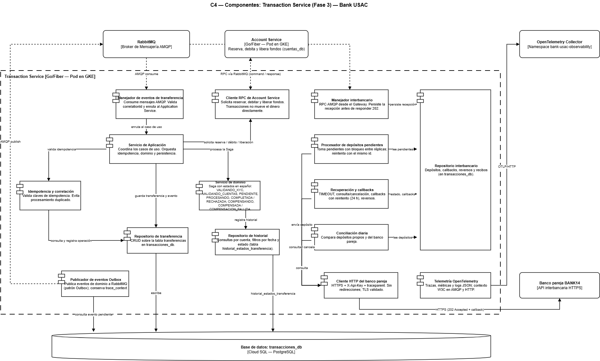

# C4 - Componentes

Este documento extiende la vista de componentes C4 (Nivel 3). La Fase 1 documentó la arquitectura interna de Transaction Service. La Fase 2 incorporó nuevas capacidades en los servicios. La Fase 3 agrega al Transaction Service el módulo interbancario y la telemetría.

---

## Transaction Service — Componentes

Transaction Service coordina las transferencias de forma asíncrona mediante una Saga. **No controla el dinero directamente:** Account Service es una dependencia crítica donde se reservan, debitan y liberan los fondos mediante RPC por RabbitMQ.

### Componentes de Transaction Service

| Componente | Responsabilidad |
|---|---|
| Transfer Event Handler | Consume mensajes AMQP; valida `correlationId`; enruta al Application Service |
| Transfer Application Service | Coordina el caso de uso; orquesta idempotencia, dominio y persistencia |
| Idempotency & Correlation | Valida claves de idempotencia; evita procesamiento duplicado |
| Transfer Domain Service | Estados de la Saga (en español, p. ej. `VALIDANDO_KYC`, `VALIDANDO_CUENTAS`, `COMPLETADA`, `RECHAZADA`); compensación; registro de historial |
| Cliente RPC de cuentas  | Solicita a Account Service, por RabbitMQ, reservar, debitar y liberar fondos |
| Transaction Repository | CRUD sobre la tabla `transferencias` en `transacciones_db` |
| History Repository | Consultas de historial por cuenta; filtros por fecha y estado (`historial_estados_transferencia`) |
| Módulo interbancario | Envía transferencias a BANK14 y procesa las recibidas; maneja `REJECTED` y `TIMEOUT` |
| Telemetría  | Métricas, trazas y logs hacia el OpenTelemetry Collector |
| Outbox / Event Publisher | Publica eventos a RabbitMQ mediante patrón Outbox |

### Dependencias externas del servicio

| Dependencia | Protocolo | Uso |
|---|---|---|
| Account Service | RPC sobre RabbitMQ | Reservar, debitar y liberar fondos |
| RabbitMQ | AMQP | Comandos, eventos y respuestas |
| `transacciones_db` (Cloud SQL) | SQL | Persistencia de `transferencias` e `historial_estados_transferencia` |
| BANK14 | HTTPS | Transferencias interbancarias |
| OpenTelemetry Collector | OTLP | Telemetría |

> El mock del laboratorio **no** aparece aquí: se comunica por HTTP en loopback dentro de un pod aislado, con un Transaction Service de laboratorio, y no es un destino del servicio productivo (ver `c4-contenedores.md`).

---

## Capacidades por servicio

| Servicio | Capacidad principal |
|---|---|
| Customer Service | Estado KYC del cliente |
| Account Service | Tipos de cuenta, saldo mínimo, comisión; reserva, débito y liberación |
| Payment Service | Simulación de pagos externos (`SUCCESS`, `FAILED`, `TIMEOUT`) |
| Notification & Audit Service | Clasificación `INFO` / `WARNING` / `ERROR` y consulta de auditoría |
| Transaction Service | Saga, historial e integración interbancaria |

---

