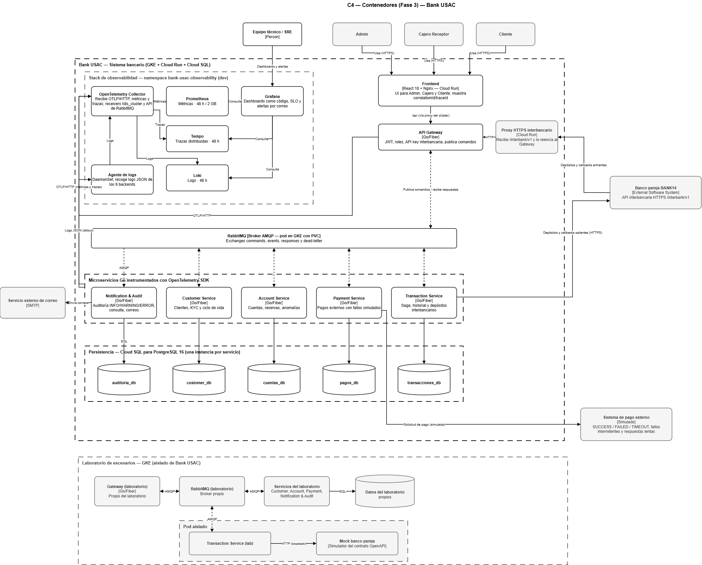

# C4 - Contenedores (Fases 2 y 3)

## Propósito

El diagrama de contenedores descompone Bank USAC en las aplicaciones y almacenes de datos que colaboran para cumplir los flujos bancarios: frontend, API Gateway, cinco microservicios, RabbitMQ, instancias de Cloud SQL, el stack de observabilidad y los accesos HTTPS publicados por Cloud Run.

---

## Diagrama de contenedores

## Contenedores de aplicación

### Frontend (React 18 + Nginx)

- **Responsabilidad:** interfaz para Administrador, Cajero Receptor y Cliente.
- **Despliegue:** Cloud Run (GCP), conforme al enunciado.
- **Interacción:** se comunica con el API Gateway; la ruta de red completa se describe en `despliegue.md`.

### Proxy HTTPS interbancario (Cloud Run)  Fase 3

- **Responsabilidad:** punto de entrada HTTPS para las llamadas de BANK14 hacia `/interbank/v1`.
- **Flujo:** BANK14 → Proxy HTTPS (Cloud Run) → API Gateway. La entrada interbancaria **no** se procesa en el frontend.

### API Gateway (Go/Fiber)

- **Responsabilidad:** punto de entrada HTTP del backend. Valida JWT, roles y propiedad de recursos; publica comandos en RabbitMQ con `correlationId` y devuelve respuestas correlacionadas.
- **Sin lógica de dominio.**
- **Fase 3:** expone `/interbank/v1` para BANK14 y enruta esas solicitudes al servicio correspondiente.

### Customer Service (Go/Fiber) — KYC

- **Responsabilidad:** clientes, usuarios, activación por correo y autenticación JWT.
- **KYC:** solo clientes en estado `VERIFIED` pueden iniciar transferencias.
- **Base de datos:** `customer_db` en `bank-usac-customer-db` (Cloud SQL).

### Account Service (Go/Fiber) — Tipos de cuenta

- **Responsabilidad:** cuentas `AHORRO` y `CORRIENTE`, saldos y movimientos. Es el único servicio que **reserva, debita y libera fondos**, atendiendo solicitudes RPC por RabbitMQ.
- **Base de datos:** `cuentas_db` en `bank-usac-account-db`.

### Transaction Service (Go/Fiber) — Historial e interbancario

- **Responsabilidad:** registro y estados de transferencias; coordina la Saga. No controla el dinero directamente: solicita a Account Service la reserva, el débito y la liberación de fondos.
- **Estados de la Saga:** en español (`VALIDANDO_KYC`, `VALIDANDO_CUENTAS`, … `COMPLETADA`, `RECHAZADA`, con compensaciones).
- **Fase 3:** módulo interbancario que envía transferencias a BANK14 por HTTPS y procesa las recibidas; estados interbancarios como `REJECTED` y `TIMEOUT`.
- **Base de datos:** `transacciones_db` en `bank-usac-transaction-db`.

### Payment Service (Go/Fiber) — Pagos externos

- **Responsabilidad:** simulación de pagos externos con respuestas `SUCCESS`, `FAILED` y `TIMEOUT`; el timeout activa compensación.
- **Base de datos:** `pagos_db` en `bank-usac-payment-db`.

### Notification & Audit Service (Go/Fiber) — Severidad

- **Responsabilidad:** consume los eventos, envía correos SMTP y mantiene la auditoría clasificada en `INFO`, `WARNING` y `ERROR`.
- **Base de datos:** `auditoria_db` en `bank-usac-notification-audit-db`.

### RabbitMQ (Broker AMQP)

- **Responsabilidad:** mensajería asíncrona entre servicios.

| Exchange | Tipo | Propósito |
|---|---|---|
| `commands` | Direct | Comandos a un servicio específico |
| `events` | Topic | Eventos de dominio |
| `responses` | Direct | Respuestas correlacionadas al Gateway |
| `dead-letter` | Fanout | Mensajes fallidos |

- **Despliegue:** pod dedicado en GKE con `PersistentVolumeClaim`.

---

## Bases de datos 

Cada microservicio es propietario de una instancia independiente de Cloud SQL para PostgreSQL. No hay consultas ni llaves foráneas entre bases de distintos servicios. Los backups son los **backups administrados de Cloud SQL**; no se usa un bucket propio.

| Base de datos | Instancia Cloud SQL | Microservicio |
|---|---|---|
| `customer_db` | `bank-usac-customer-db` | Customer Service |
| `cuentas_db` | `bank-usac-account-db` | Account Service |
| `transacciones_db` | `bank-usac-transaction-db` | Transaction Service |
| `pagos_db` | `bank-usac-payment-db` | Payment Service |
| `auditoria_db` | `bank-usac-notification-audit-db` | Notification & Audit |

---

## Observabilidad  Fase 3

Namespace `bank-usac-observability`.

| Contenedor | Función | Retención |
|---|---|---|
| Agente de logs | Recolecta logs de los pods | — |
| OpenTelemetry Collector | Recibe telemetría y logs; los reenvía a los backends | — |
| Prometheus | Métricas | Hasta 30 días o 2 GB |
| Tempo | Trazas | 48 h |
| Loki | Logs | 48 h |
| Grafana | Dashboards y alertas | — |

- **Ruta de logs:** Agente de logs → Collector → Loki (el agente no escribe directamente en Loki).
- **Acceso a Grafana:** mediante un proxy HTTPS en Cloud Run hacia el acceso privado de Grafana.

---

## Laboratorio de escenarios - Fase 3

Entorno **aislado** en GKE para demostrar escenarios de fallo interbancario. Tiene su propio Gateway, RabbitMQ, servicios y datos, y el mock de BANK14 en un pod aislado donde un Transaction Service de laboratorio lo invoca por **HTTP en loopback**.

- El mock **no es una alternativa de BANK14** ni un destino del Transaction Service normal. El servicio productivo no alterna entre BANK14 y el mock.
- Ninguna conexión une el laboratorio con los servicios ni con los datos productivos.

---

## Relación con las vistas del sistema

| Vista | Documento | Alcance |
|---|---|---|
| Contexto | `c4-contexto.md` | Bank USAC como un sistema, usuarios, BANK14 y correo |
| **Contenedores** | **este documento** | Microservicios, Gateway, RabbitMQ, Cloud SQL, observabilidad y laboratorio |
| Componentes | `c4-componentes.md` | Estructura interna de Transaction Service |
| Despliegue | `despliegue.md` | Dónde se ejecutan los contenedores en GCP |

---

## Recorrido principal (transferencia con Saga)

1. El cliente opera desde el frontend; el Gateway valida JWT y KYC.
2. Transaction Service inicia la Saga y solicita a Account Service, por RPC en RabbitMQ, validar cuentas y reservar fondos.
3. Account Service reserva y debita; Transaction Service avanza los estados.
4. Si el destino es otro banco, se envía a BANK14 por HTTPS; si responde `REJECTED` o `TIMEOUT`, la Saga compensa liberando fondos.
5. Transaction Service registra el estado final (`COMPLETADA` o `RECHAZADA`) en el historial.
6. Notification & Audit clasifica el evento y lo registra en `auditoria_db`.
7. El Gateway devuelve la respuesta correlacionada al frontend.