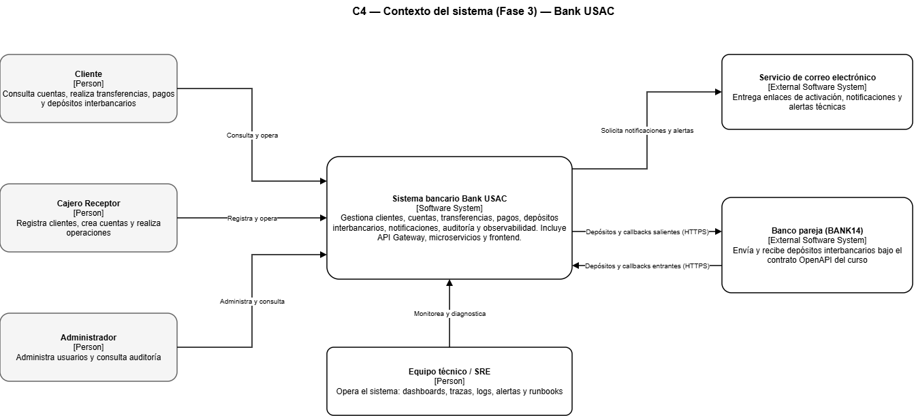

# C4 - Contexto del sistema

Este diagrama representa a **Bank USAC** como un único sistema (caja negra) y lo relaciona con sus usuarios y con los sistemas externos. En Fase 3 se agrega la integración interbancaria con BANK14 y la operación del sistema por parte del equipo técnico/SRE.

## Actores y sistemas externos

| Elemento | Tipo | Relación con Bank USAC |
|---|---|---|
| Administrador | Usuario | Gestiona usuarios, clientes y auditoría |
| Cajero Receptor | Usuario | Registra depósitos y atiende operaciones en ventanilla |
| Cliente | Usuario | Consulta cuentas y realiza transferencias |
| Equipo técnico / SRE | Usuario interno | Opera y monitorea el sistema (dashboards, alertas) |
| BANK14 | Sistema externo | Banco con el que se intercambian transferencias interbancarias por HTTPS (envío y recepción) |
| Servicio de correo | Sistema externo | Recibe de Bank USAC los correos de activación y las alertas |

## Alcance del diagrama

- Bank USAC aparece como **un solo sistema**. El API Gateway, los microservicios, RabbitMQ y las bases de datos son piezas internas y no se dibujan aquí.
- No se muestran protocolos internos (AMQP, SQL). Esos detalles corresponden al diagrama de contenedores (`c4-contenedores.md`).
- La relación con BANK14 es bidireccional: Bank USAC envía transferencias a BANK14 y recibe las que BANK14 origina.
- El laboratorio de escenarios no forma parte del contexto: es un entorno aislado de pruebas.