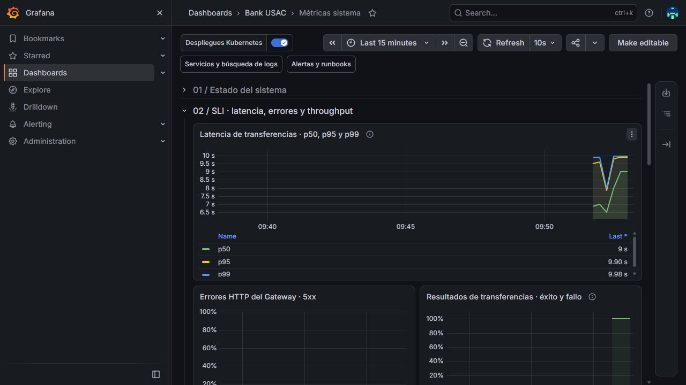
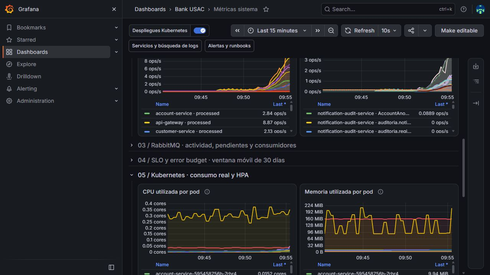
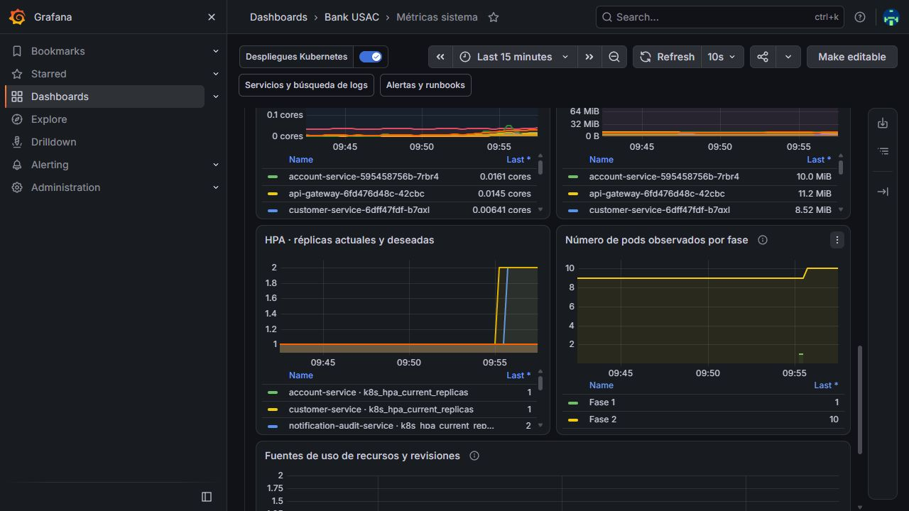

# Prueba de carga de transferencias — producción

**Ejecutada en producción.** Existen resultados reales y evidencia de
escalamiento automático. **No pasó el objetivo de latencia de aceptación HTTP.**
No confundir la existencia de la prueba con el cumplimiento de todos los SLO.

## Entorno y procedimiento

- Aplicación: `https://bank-usac-frontend-prod-2atv2f4ufq-uc.a.run.app`.
- Namespace `bank-usac`, versión desplegada `v3.0.1`, revisión base
  `38ac4fb6ef0993b802e1d8e3be7dc500d454ac8e`.
- Generador k6 1.6.0 ejecutado en Windows contra el HTTPS público de Cloud Run.
  Binario oficial con SHA-256 contrastado con el archivo de checksums del release.
- Carpeta de evidencia: `ejecucion-produccion`. El identificador técnico original
  de la ejecución se conserva dentro de los registros para su trazabilidad.
- Cliente **nuevo y exclusivo de prueba**, activo y KYC verificado; 16 cuentas
  corrientes (ocho pares), sin comisión. No se usó la cuenta personal del usuario.
- Fondos estudiantiles iniciales: Q16,000 en conjunto. Cada transferencia fue de
  Q0.01, alternando origen y destino dentro de cada par.
- Flujo interno real por Gateway, RabbitMQ, KYC, cuentas y Saga. Resultado del
  proveedor simulado seleccionado como `EXITO`. **No hubo llamadas a BANK14**.
- Primero tres operaciones con un usuario. Después rampa 1→2→4→8, tres minutos
  sostenidos y descenso a cero: seis minutos de etapas más cierre de operaciones.
- Cada usuario tuvo su propio par. Máximo autorizado de este perfil: 1,600
  operaciones. No se alcanzó ese límite: se ejecutaron 153 en la rampa.
- Se esperó el estado durable `/api/transferencias/:id`; un 202 no se contó como
  operación completada. No se reintentaron POST ni se reutilizaron transferencias.

## Resultados

| Medición | Comprobación inicial | Carga gradual |
|---|---:|---:|
| Operaciones enviadas / aceptadas / completadas | 3 / 3 / 3 | 153 / 153 / 153 |
| Fallos de transferencia | 0 | 0 |
| Operaciones sin resultado terminal | 0 | 0 |
| Error HTTP observado por k6 | 0 % | 0 % |
| Usuarios concurrentes máximos | 1 | 8 |
| Duración medida por k6 | 44.09 s | 374.06 s |
| Throughput medio de operaciones completadas | 0.068/s | 0.409/s |
| Latencia completa p50 | 13.924 s | 13.900 s |
| Latencia completa p95 | 14.667 s | 14.011 s |
| Latencia completa p99 | 14.733 s | 14.727 s |
| HTTP POST de aceptación p95 | 3.884 s | **3.216 s** |
| Objetivo POST p95 <500 ms | **No cumple** | **No cumple** |

La latencia completa se mide desde el envío hasta observar el estado terminal;
incluye red, broker, procesamiento y resolución del sondeo (hasta 500 ms más el
tiempo de respuesta del GET). Es distinta a la duración de la Saga registrada
por el servidor y a la latencia del POST de aceptación.

Ambos procesos k6 terminaron con **código 99 exclusivamente por el umbral HTTP**;
no fueron abortados por fallos de transferencia. No se elevaron umbrales para
hacer pasar la prueba. El límite de 60 s del generador es una protección operativa,
no una declaración de cumplimiento del SLO de negocio del enunciado.

## HPA y creación real de pods

Los HPA conservaron su objetivo de CPU al **80 %** y límites existentes. No se
cambiaron requests/limits, no se generó CPU sintética ni se escalaron despliegues
manualmente. Se tomaron **39 observaciones** del API de Kubernetes.

| Servicio | Réplicas observadas | Pico de CPU según HPA (% de request) |
|---|---:|---:|
| Account | 1 | 30 % |
| Customer | 1 | 15 % |
| Notification & Audit | **1 → 2** | **158 %** |
| Payment | 1 | 16 % |
| Transaction | 1 | 55 % |

- Creación del pod
  `notification-audit-service-7dfc865f69-d4c7h`.
- Primera muestra observada con dos réplicas deseadas.
- Primera muestra observada con dos réplicas disponibles,
  pod nuevo Running/Ready y cero reinicios.
- Grafana también observó el aumento de nueve a diez pods del namespace.

Esto demuestra un escalamiento automático **de Notification & Audit durante la
carga de transferencias**. No demuestra que Transaction o Payment hayan escalado:
ambos permanecieron en una réplica y se registra explícitamente. Tampoco demuestra
expansión de nodos ni el escalamiento de todos los servicios.

### Qué requisito queda demostrado

El enunciado de Fase 3 (páginas 9 y 10) pide evidenciar escalamiento bajo carga
y creación de pods por el HPA en los dashboards. En ese apartado no exige que
todos los microservicios escalen ni que necesariamente lo hagan Transaction o
Payment. Esta ejecución **sí demuestra ese requisito de evidencia del HPA**:
Notification & Audit pasó de una a dos réplicas y el nuevo pod quedó disponible.
Los otros servicios no superaron el objetivo de CPU y conservaron una réplica.

Esto no equivale a aprobar toda la sección de carga y fallos de la rúbrica:
también requiere tres escenarios de fallo y compensaciones visibles. La latencia
HTTP que no pasó el umbral de 500 ms es un resultado distinto del escalamiento.

## Conciliación posterior

Comprobación por API después de finalizar la carga:

- Historial exclusivo del cliente: **156 transferencias**, todas `COMPLETADA`;
  coincide con las 3 + 153 aceptadas por k6.
- Saldo conjunto inicial y final: **1,600,000 centavos (Q16,000)**.
- Reservas: **cero**. Comisiones de las cuentas: cero.
- Se verificaron pertenencia al fixture, descripción de ejecución, importe,
  estados, ausencia de IDs repetidos y saldos no negativos.
- No se modificaron operaciones históricas de otros clientes ni se borró evidencia.

## Evidencia

Carpeta: [ejecucion-produccion](evidencia-carga/ejecucion-produccion/).

- [Resumen k6 inicial](evidencia-carga/ejecucion-produccion/smoke-summary.json).
- [Resumen k6 de carga](evidencia-carga/ejecucion-produccion/load-summary.json).
- [Tiempos, revisión y ejecución](evidencia-carga/ejecucion-produccion/execution.json).
- [Conciliación independiente](evidencia-carga/ejecucion-produccion/conciliacion.json).
- [Disponibilidad y HPA después de la carga](evidencia-carga/ejecucion-produccion/post-run-health.json).
- [Observaciones HPA y pods](evidencia-carga/ejecucion-produccion/hpa.jsonl).
- [Series originales de Prometheus](evidencia-carga/ejecucion-produccion/prometheus.json).

### Latencia y resultados durante la carga

La gráfica registra la duración del flujo medida por el servidor. El p95 HTTP
de aceptación y la duración completa observada desde k6 se presentan por separado
en la tabla de resultados; no son la misma medición.

### CPU y memoria por pod

### Escalamiento automático y pod nuevo disponible

El incremento corresponde a Notification & Audit. Las observaciones de Kubernetes
adjuntas identifican el pod nuevo y confirman que quedó Running/Ready, sin reinicios.

La ventana de ejecución se conserva en `execution.json`. Ajustar ese intervalo en
Grafana antes de consultar; las capturas conservan la evidencia aunque venza la
retención corta de métricas. Los valores de Prometheus del namespace pueden
incluir actividad simultánea de otros usuarios: los conteos exclusivos del ensayo
son los de k6 y la conciliación por cliente, no el total global del dashboard.

## Reproducción y límites

Scripts e instrucciones: [tools/load/README.md](../../tools/load/README.md).
Los tokens y la contraseña del fixture están fuera del repositorio. No publicarlos.
Las cuentas se conservaron para permitir inspección y repetición; no se borraron.

La comprobación posterior encontró todos los despliegues de
producción disponibles, salud HTTPS 200 y dev con cero réplicas. Notification &
Audit volvió automáticamente a una réplica al retirarse la carga; no se forzó
manualmente su reducción.

Las notificaciones del cliente usan el dominio reservado `.invalid`: no se
mandan correos a personas. Los intentos/fallos de entrega y su trabajo de reintento
forman parte de la carga observada de Notification & Audit; este ensayo **no
certifica SMTP** ni representa ocho clientes independientes con correos válidos.

El perfil opcional `capacity` está implementado con consentimiento separado y
límite de 64 usuarios, pero **no se ejecutó**: el perfil normal ya produjo
escalamiento. No atribuirle resultados a ese perfil.

Pendiente importante: diagnosticar y reducir la latencia de aceptación (p95
3.216 s frente a 500 ms), sin confundirlo con la duración completa de la Saga.
Esta prueba no sustituye fallos controlados, SLO de 30 días ni pruebas con BANK14.
